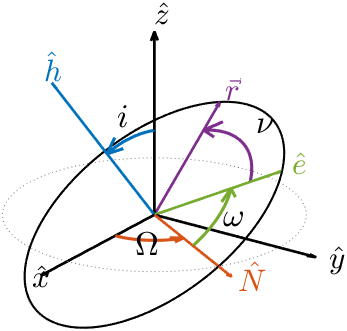

# plotAngleArc3d

[](https://github.com/alebeigit/plotAngleArc3d/actions/workflows/tests.yml)
[](LICENSE)

Draw the arc that marks the angle between two vectors in a 3D MATLAB plot, with
an optional label and arrowhead.

MATLAB has no built-in way to annotate angles in 3D: `annotation` only works in
2D figure coordinates. `plotAngleArc3d` draws the arc in data coordinates, so it
rotates, zooms and exports with the rest of the plot.



## Features

- Minor angle (0–180°) or reflex angle (180–360°).
- Fixed direction of rotation through a plane normal, for angles from 0 to 360°.
- Right-angle square drawn automatically for 90° angles.
- Optional arrowhead and label, including LaTeX.
- Any line property: `Color`, `LineWidth`, `LineStyle`, `DisplayName`, ...
- Works on any axes (`Parent`), whatever the `hold` state; accepts 2D vectors too.

## Installation

Requires **MATLAB R2021a** or later. No toolboxes needed.

Clone the repository (or download it as a ZIP) and add the folder to the MATLAB path:

```matlab
addpath("path/to/plotAngleArc3d")
```

## Quick start

```matlab
v1 = [1 0 0];
v2 = [0.3 1 0.5];

figure, hold on, axis equal, grid on, view(3)
quiver3(0, 0, 0, v1(1), v1(2), v1(3), 0, "k")
quiver3(0, 0, 0, v2(1), v2(2), v2(3), 0, "k")

plotAngleArc3d(v1, v2, Radius=0.4, Arrow=true, Color="r", LineWidth=1.5, ...
    Label="$\theta$", LabelProperties={'Interpreter', 'latex', 'FontSize', 14})
```

The arc starts on `v1` and ends on `v2`. Vectors can be rows or columns.

## Syntax

```matlab
plotAngleArc3d(v1, v2)
plotAngleArc3d(v1, v2, Name=Value)
[hArc, hLabel, labelPos] = plotAngleArc3d(___)
```

### Options

| Name | Default | Description |
|---|---|---|
| `Origin` | `[0 0 0]` | Common tail of `v1` and `v2`. |
| `Radius` | `0.3` | Arc radius, in data units. |
| `Reflex` | `false` | Draw the reflex angle (360° minus the minor one), still from `v1` to `v2`. |
| `Normal` | `[]` | Plane normal. The arc goes counter-clockwise from `v1` to `v2` as seen from the tip of `Normal` (right-hand rule), so it can span 0–360°. `v1` and `v2` are projected onto the plane first. Cannot be combined with `Reflex`. |
| `RightAngleMarker` | `true` | Draw a square for 90° angles. |
| `NumPoints` | `101` | Number of points along the arc. |
| `Arrow` | `false` | Draw an arrowhead at the `v2` end. |
| `ArrowSize` | `[]` | Arrowhead side length in data units; `[]` scales it with `Radius`. |
| `Label` | `""` | Text placed next to the middle of the arc. |
| `LabelOffset` | `1.25` | Label distance from `Origin`, as a multiple of the arc midpoint distance. |
| `LabelProperties` | `{}` | Name-value pairs passed to `text`, e.g. `{'Interpreter','latex'}`. |
| *line properties* | `Color="k"` | Any property of a line object, including `Parent` to choose the axes. |

### Outputs

| Output | Description |
|---|---|
| `hArc` | Line object for the arc and its arrowhead. |
| `hLabel` | Text object, or empty when there is no `Label`. |
| `labelPos` | 3×1 point where the label is placed. Returned even without a label, to place your own annotation. |

### Special cases

- **Opposite vectors (180°):** the plane of the angle is undefined, so an arbitrary
  one is chosen and a warning is issued. Pass `Normal` to choose it.
- **Same direction (0°):** nothing is drawn and a warning is issued.
- **New axes:** `plotAngleArc3d` does not change the view; call `view(3)` to see a 3D arc.

## Examples

[`examples/demo_plotAngleArc3d.m`](examples/demo_plotAngleArc3d.m) draws a
feature overview and the orbital-elements figure above:

```matlab
run("examples/demo_plotAngleArc3d.m")
```

## Running the tests

From the repository root:

```matlab
results = runtests("tests")
```

## Upgrading from 1.x

Version 2.0 replaced the positional inputs of the
[File Exchange version](https://www.mathworks.com/matlabcentral/fileexchange/127654-plot-any-three-dimensional-3d-angle)
with name-value options:

| 1.x | 2.0 |
|---|---|
| `plotAngleArc3d(+1, v1, v2)` | `plotAngleArc3d(v1, v2)` |
| `plotAngleArc3d(-1, v1, v2)` | `plotAngleArc3d(v1, v2, Reflex=true)` |
| `originvec` | `Origin=originvec` |
| `ArcRadius` | `Radius=r` |
| `ArcStyle = {'-r', 'LineWidth', 1.7}` | `Color="r", LineWidth=1.7` |
| `ArcLabel` | `Label="..."` |
| `ArcLabelStyle` | `LabelProperties={...}` |
| `ArrowedAngle = 1` | `Arrow=true` |
| `ArrowedAngle = s` (s ≠ 1) | `Arrow=true, ArrowSize=s` |
| `[h, AngleArcLabelvec]` | `[hArc, ~, labelPos]` |

See the [changelog](CHANGELOG.md) for everything that changed, including bug fixes.

## License

BSD 3-Clause. See [LICENSE](LICENSE).

## Author

Alessandro Beolchi. Originally written for 3D figures of orbital mechanics in a
Master's thesis in Space and Astronautical Engineering.
